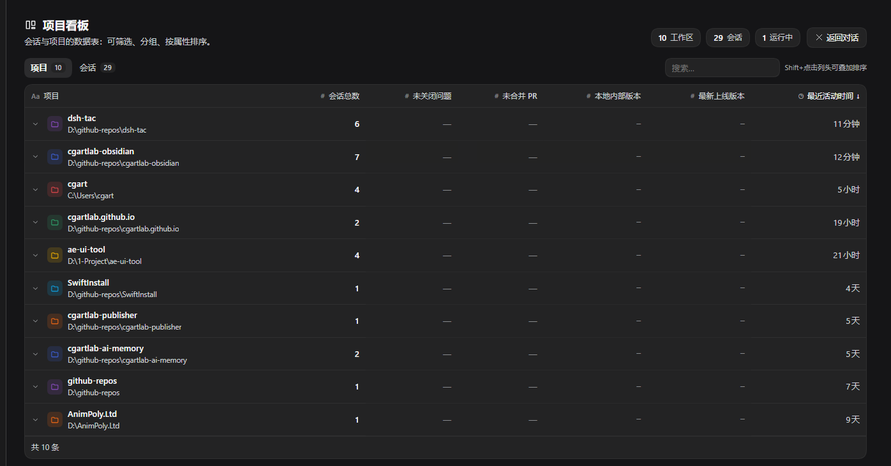
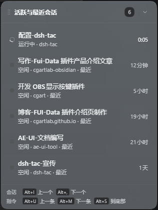
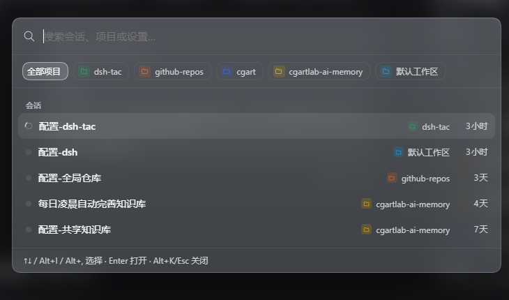

# dsh-tac

[](https://github.com/cgartlab/dsh-tac/actions/workflows/check.yml)
[](https://creativecommons.org/licenses/by-nc-sa/4.0/)

English | [中文](README.zh.md)

A [DeepSeek Harness](https://deepseek.com) client plugin that turns the harness into a
project-aware workspace: a global project/session board in the native right sidebar, a
floating session HUD, keyboard-first session navigation, hold-to-scroll conversation
reading, and desktop-class task notifications.



| Floating session list | Command palette (sessions / projects / settings) |
| --- | --- |
|  |  |

## Features

- **Project board** — session and project database views with search, status/type/project
  filters, grouping, multi-column sorting, archive-aware rows, and per-project color and
  icon. The project view has 6 attribute columns (session count / Open Issue / Open PR /
  local version / latest release / last activity). **Click a project row to expand its
  session list inline below** (accordion-style, no page flip). Opens at narrow (380 px),
  medium (50 vw) or native fullscreen — each size key is its own toggle: any of them closes an
  open board, and a closed board opens at the size you pressed. Past 200 sessions the list
  renders in batches with a "show more" control. The right-pane board and the fullscreen main
  panel are separate instances, each remembering its own tab.
  The pane's open state and size belong to the workspace, not to each conversation:
  switching sessions only switches the conversation and never re-opens, closes or resizes
  the board.
- **Floating session HUD** — live active/recent sessions with timers, attention badges,
  automation markers, drag-to-move, and an animated pill ⇄ list collapse; while the native
  left sidebar is open the list collapses to a pill that sits just right of that sidebar and
  returns when it closes (a list you dragged keeps its own vertical spot; one still at its
  default anchor only collapses, it does not jump across the screen). One stable order:
  active sessions first, most recent activity first within a group; switching sessions
  highlights the new row without reshuffling the list, and `⌥+I` / `⌥+,` cycle in
  exactly that order.
- **Command palette** (`⌥+K`) — fuzzy search over sessions and projects, and now over
  settings too (the input prompts for "sessions, projects or settings"). With a keyword,
  results are split into three labelled groups: **Settings** (the host's own settings
  sections, discovered live), **Project Board settings** (the six sections of this plugin's
  settings page — Shortcuts, Top function buttons, Interface and behavior, GitHub data
  source, Logs & diagnostics, Data) and **Sessions** (the original results). Setting rows
  carry their own icon and group headers, and `⌥+I` / `⌥+,` / `↑` / `↓` move continuously
  across all groups; `Enter` opens the session or jumps to the setting. An empty query still
  shows only the familiar session list, and the project filter chips narrow sessions only —
  settings are global. Selecting a setting opens the host Settings page at that section;
  plugin settings also scroll to their section and briefly highlight it. If Settings opens
  but the section cannot be preselected, an info toast says so; if it cannot be opened at
  all, a warn toast points you to the sidebar — a partial success is never silent. Sections
  the host or other plugins add later appear in search without a plugin update.
- **Archived sessions on their own** — one chip ("Archived only", archive glyph) narrows the
  list to archived sessions and switches back on a second click. Each archived row carries a
  **restore** button that unarchives it in place, without leaving the search or opening another
  screen; with the keyboard, `Shift+Enter` restores the highlighted archived row (the footer
  hint appears only when the selection is archived). The filter is an explicit request, so it
  still shows archived rows even when "include archived in search" is switched off. `Esc`
  clears the filters (project and archived together) before a second press closes the panel.
- **Hold-to-scroll reading** — the conversation scrolls smoothly while the key is held,
  loads older history automatically before reaching the boundary (when "history on scroll"
  is enabled), and falls back to anchor stepping if the chat view reverts a position write.
  Holding `⌥+M` down to the end activates the composer so a reply can be typed immediately.
- **History on scroll** — scrolling a long conversation to the top loads the previous page
  of older messages without clicking "Load earlier" every time. On by default, switchable
  off in settings. It drives the host's own pager, so its loading and error feedback and its
  scroll-position anchoring behave exactly as they do for a manual click.
- **Task notifications** — a session finishing a turn, waiting for an answer, or asking
  for permission raises an in-app card at the bottom-right of the conversation with a
  chime; when the app is in the background a system notification carries the full question
  text and every option. A turn that **fails** is reported as a failure rather than a
  completion, with the readable reason in the body; an approval reason supplied as an
  `{en, zh}` object is rendered as text instead of `[object Object]`.
- **Session actions** — the `⌥+D` dialog can archive, delete (where the host exposes it),
  and **stop a running turn** (`remote.session.cancel`); queued messages survive a stop.
- **Conflict-aware shortcuts** — recording a combination already used by this plugin or by
  a built-in DSH command is rejected inline, and saved conflicts are reported at startup.
- **Logs & diagnostics** — optional local logs (error / warn / info / debug) with a bounded ring buffer, copy and clear actions in settings, startup checks for shortcut collisions with built-in commands, and captured window errors and rejected promises.
- **Archive from the HUD** — hovering a session row swaps its timer for an archive button; the search palette can include archived sessions (marked "Archived"), controlled by a setting that is on by default.
- **GitHub data source** — map each project to its GitHub repo (owner/repo) and a local version in **Settings → GitHub 数据源**; the board's Open Issue / Open PR / latest-release columns then show live numbers read straight from api.github.com (a Personal Access Token is optional for public repos). Unmapped projects keep a "—" placeholder.

## Keyboard shortcuts

Every shortcut is configurable in **Settings → 项目看板设置**. Defaults:

On macOS these use `⌥` (Option), `⌃` (Control), `⇧` (Shift) and `⌘` (Command); `⌥` is the
physical Option key. On Windows and Linux the same combinations are shown as `Alt+…` /
`Meta+…`. Stored bindings stay platform-neutral, so saved shortcuts need no migration.

| Shortcut | Action |
| --- | --- |
| `⌥+K` | Open / close the command palette (sessions, projects and settings) — inside, `⌥+I` / `⌥+,` / `↑` / `↓` move the selection across all groups, `Enter` opens the session or jumps to the setting, `Shift+Enter` restores a highlighted archived row |
| `⌥+I` / `⌥+,` | Previous / next session |
| `⌥+U` / `⌥+M` | Previous / next user instruction (tap to jump, hold to scroll) |
| `⌥+S` | Scroll to bottom and focus the composer |
| `⌥+D` | Session actions dialog (archive / stop a running turn / delete where the host exposes it) |
| `⌥+N` / `⌥+B` / `⌥+V` | Board at narrow / medium / fullscreen. Any of them closes an open board; a closed board opens at the size you pressed |
| `⌥+W` | Show / hide the native left sidebar; leaves a fullscreen board first |
| `⌥+R` | Rename the current session |
| `⌥+E` | Collapse / expand the floating session list |
| `⌥+Enter` | Steer the earliest queued message into the running turn |

While the command palette is open, **window-level** keys (board / left sidebar / floating list /
rename / session menu) dismiss it and then act; **conversation-level** keys (steer, hold-scroll,
scroll-to-bottom, session cycle) stand down so typing is never interrupted.

## Requirements

- A DeepSeek Harness build with client plugin support and the client packages
  `dsh-client-ui-sidebar`, `dsh-client-ui-workspace`, and `dsh-client-ui-session`.
- Node.js 18+ only for repository checks; the plugin itself is loaded by the harness.

**Verified against**: DSH `0.2.2-rc.1` (desktop app on macOS / Windows, and the web UI).
DSH is in developer preview; the plugin only uses public client services, but an upstream
breaking change may still need a follow-up release — please include your DSH version in issues.

## Install

You need two things: **DeepSeek Harness (DSH) already installed**, and **access to GitHub**.
No Node setup, no `npm install` — the plugin has zero runtime dependencies and React comes from
DSH itself.

### Option 1: install inside DSH (easiest)

No terminal needed:

1. Open DSH and click **Plugins** in the left sidebar;
2. click **"+ Add plugin"** in the top right;
3. type **`dsh-tac`** (a GitHub URL or a local directory also works);
4. click **Install**, then **restart DSH**.

It then shows up under "installed plugins" with its own on/off switch. The installer registers
the plugin in the profile you are running — there is no config file to edit by hand. Now check
**After installing: what you should see** and **If nothing appears** below; both sections apply
to either install option.

### Option 2: install from the command line

**First, find the `dsh` command.** The desktop app ships its own CLI and does not put it on
`PATH`. It lives here:

| Platform | Path |
| --- | --- |
| Windows | `%LOCALAPPDATA%\Programs\DeepSeek Harness\resources\runtime\cli\bin\dsh.cmd` |
| macOS | `/Applications/DeepSeek Harness.app/Contents/Resources/runtime/cli/bin/dsh` |

Add it to `PATH` if you want plain `dsh`, otherwise use the full path. On macOS, without changing
`PATH`, the whole command looks like this:

```bash
"/Applications/DeepSeek Harness.app/Contents/Resources/runtime/cli/bin/dsh" plugin --profile desktop add dsh-tac
```

On Windows PowerShell, replace `dsh` with the full `.cmd` path:

```powershell
& "$env:LOCALAPPDATA\Programs\DeepSeek Harness\resources\runtime\cli\bin\dsh.cmd" plugin --profile desktop add dsh-tac
```

**Then confirm your profile name.** That is the configuration you actually run; look at what
exists:

```bash
ls ~/.dsh/profiles/
```

The desktop app is usually `desktop`; `npx @deepseek-ai/dsh web` creates `web`, and you may have
other profiles of your own. Use the one DSH is actually running. **Do not guess this** —
installing into the wrong profile leaves the plugin installed but completely inactive.

Install it (replace `desktop` with the name you just saw):

```bash
dsh plugin --profile desktop add dsh-tac
```

That installs from npm (`dsh plugin` forwards `add <pkg>` to pnpm inside that profile). To track
the latest commit on `main` instead, use the source form:

```bash
dsh plugin --profile desktop add github:cgartlab/dsh-tac
```

Both commands **register the plugin in that profile's `dsh.profile.bundles`** automatically — no
hand-editing the JSON. Then **restart DSH**.

### After installing: what you should see

Both install options lead to the same result. After a full restart you should immediately see:

- a **floating session list** in the bottom-left ([screenshot](docs/screenshots/hud.png));
- a **search box and a few buttons** in the conversation header;
- a **project board** when you open the right pane, or press `Alt+N` / `Alt+B` / `Alt+V`
  (`⌥+N` / `⌥+B` / `⌥+V` on macOS) to open it at narrow / medium / fullscreen size
  ([board screenshot](docs/screenshots/board.png)); `Alt+K` (`⌥+K`) opens the
  [command palette](docs/screenshots/palette.png).

### If nothing appears

This applies to both install options. Check in this order:

1. **Wrong profile, or not registered.** Run `ls ~/.dsh/profiles/` again and confirm the name you
   passed to `--profile` is the profile DSH actually runs. `dsh-tac` should be listed in
   `dsh.profile.bundles` of `~/.dsh/profiles/<name>/package.json` (`dsh plugin add` and the GUI
   installer write it automatically — only add it by hand if it is genuinely missing). The
   `cordis.yml` in the same folder is generated by DSH; do not edit it by hand.
2. **Plugin switched off.** In **Plugins → installed plugins**, make sure `dsh-tac` is enabled.
3. **Not fully restarted.** Closing the window is not quitting: on macOS use `⌘+Q`, on Windows
   quit from the tray icon, then start DSH again. Client bundles are only loaded at startup.
4. **Old package name left over.** The plugin was once published as
   `@local/dsh-project-board` / `@local/dsh-tac`. If you installed one of those long ago, check
   that the profile has no leftover old entry — an old alias does not load the current
   `dsh-tac` package.
5. Still stuck? Open **⋯ More → Settings → 项目看板设置 → 日志与排查**, set the level to
   **Normal (recommended)**, restart, and look for a `plugin ready` entry.

### Where the plugin's own settings live

At the bottom of the DSH sidebar, **`⋯ More` → `Settings`** (or `Ctrl+,`), then pick
**"项目看板设置"** in the left-hand list. Everything is there: all shortcuts, floating-list
behaviour, the board's default view, the GitHub data source and the log level.

### Option 3: link the source while developing

Use this when you want your local checkout, not the published one:

```powershell
plugin_manager install_bundle target="<this repository>"
```

The package is `dsh-tac` and inserts itself as the `dsh-tac` loader entry.
`package.json` exposes `dsh.bundle.patch` and `dsh.client`; the plugin injects into
`conversation.header.leading`, `conversation.session.header.utilities`,
`conversation.composer.dock`, `shell.overlay`, and `settings.section`.

### Making a source change take effect

The plugin ships as a client bundle, so after editing `src/` rebuild and hot-reload:

```bash
npm install        # first time only
npm run build      # src/ → client.js + index.js
```

Then disable and re-enable the plugin under **Settings → Plugins**, or press `Ctrl+R`.
The built artifacts are committed; `npm run check` verifies they match the sources.

### Uninstall

```bash
dsh plugin --profile desktop remove dsh-tac
```

Or disable `dsh-tac` under **Settings → Plugins**. The plugin writes no DSH data; what survives
an uninstall is only its own settings and logs (kept in browser localStorage).

### Permissions & data

- Read the session list and status, switch sessions, rename, archive — all through DSH's public
  client services. It **does not read conversation content**.
- Optional: the public GitHub API, for the Open Issue / PR / latest-release columns. Requests are
  only made for repositories **you** map in settings; a token (kept on this machine) is needed
  for private repositories.
- Optional: system notifications, subject to the OS/DSH permission.
- Settings and logs stay in this browser's localStorage. No DSH data is written and nothing is
  uploaded; the plugin has zero runtime dependencies.

## How it is built

The plugin is written in **TypeScript** under `src/` and compiled into a single client bundle
(`client.js`) by esbuild. The bundle is loaded through the harness client module loader, uses
only public client services (`ctx.slots`, `ctx.sidebarRight`, `ctx.layout`,
`ctx.get('workspaces')`, session status stores) and takes React from the host. It ships with no
runtime dependencies of its own; host-half `index.js` is intentionally a no-op.

This is a **client-half plugin**: the required `apply(ctx)` entry is exported the way a DSH
client plugin specifies it — `window.__ModuleLoader__.load({ id, factory })`, whose factory
returns `{ inject, apply }` (`src/index.ts`). The top-level `index.js` is deliberately empty
because everything runs in the browser, so a reviewer looking for `apply` should read
`src/index.ts` / `client.js` rather than `index.js`.

- `src/index.ts` — entry the harness injects; binds the host React and calls `apply`
- `src/apply.ts` — dictionaries, styles, stores, native board/sidebar actions, slot wiring
- `src/features/` — board, floating list, palette + shortcut dispatcher, notifications, dialogs, settings page, chat scrolling
- `src/core/` — settings/migration, logging, combos, stores, DOM probes, schedule + preset sources, palette settings catalog
- `src/i18n/` — zh/en dictionaries (key parity is a compile-time error)
- `client.js`, `index.js` — generated artifacts (never edit by hand)
- `cordis.patch.yml` — bundle insertion
- `locale/` — zh/en trailer strings
- `scripts/` — build plus manifest, syntax and i18n checks used locally and in CI
- `docs/architecture.md` — slot map, state, keyboard and notification internals

## Known limitations

- Session deletion depends on the client contract; this build of DeepSeek Harness does not
  expose it, so the session dialog disables delete and points to archive instead.
- Archiving a session that is still running is rejected by the host; the dialog surfaces
  the error rather than forcing it.
- System notifications follow the OS/browser notification permission and the harness
  WebView autoplay policy for the chime.
- The plugin targets the current client slot and service surface; a harness update that
  renames those slots would need a matching plugin update.

## Development

```bash
npm ci                          # toolchain: typescript + esbuild
npm run typecheck               # tsc --noEmit (strict)
npm run build                   # src/ -> client.js + index.js
npm run check                   # typecheck, manifest/exports/syntax, i18n parity
npm test                        # bundle + shortcut regression suite
```

`client.js` and `index.js` are generated; CI rebuilds them and fails if the committed
artifacts differ from `src/`. All checks run on every push and pull request
(`.github/workflows/check.yml`).

## Marketplace listing

Everything a marketplace submission asks for, and where each field lives in this repo:

| Field | Value / where to find it |
| --- | --- |
| One-line value | A keyboard-first project board, floating session HUD and command palette for DeepSeek Harness — see every session and project at a glance. |
| Category | DSH client plugin · productivity / project management (GitHub topic `dsh-plugin`; `package.json` `keywords`). |
| Install command | `dsh plugin --profile <profile> add dsh-tac`, or the in-app **"+ Add plugin"** flow. Full steps in **Install** above. |
| Compatibility | Verified against DSH `0.2.2-rc.1` (desktop on macOS / Windows, and the web UI); Node 18+ is only needed for repository checks. See **Requirements**. |
| License | `CC-BY-NC-SA-4.0` — `package.json` `license`, the badge at the top, and **License** below. |
| Screenshots | `docs/screenshots/board.png`, `hud.png`, `palette.png` — all embedded near the top of this README; capture and freshness rules live in [docs/screenshots.md](docs/screenshots.md) and are enforced by `npm run check`. |
| Permissions & data | See **Permissions & data** above: session list/status only, optional GitHub API and system notifications, no conversation content and no upload. |

## License

Licensed under [Creative Commons Attribution-NonCommercial-ShareAlike 4.0 International](https://creativecommons.org/licenses/by-nc-sa/4.0/),
the same license as [cgartlab.com](https://cgartlab.com).

Copyright (c) 2025-2026 CGArtLab.


