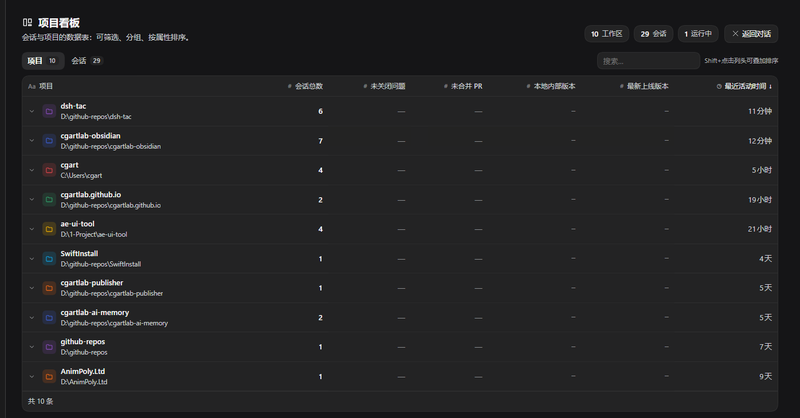
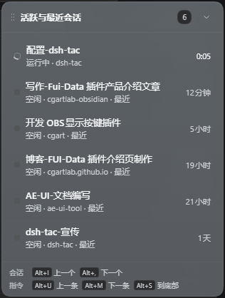
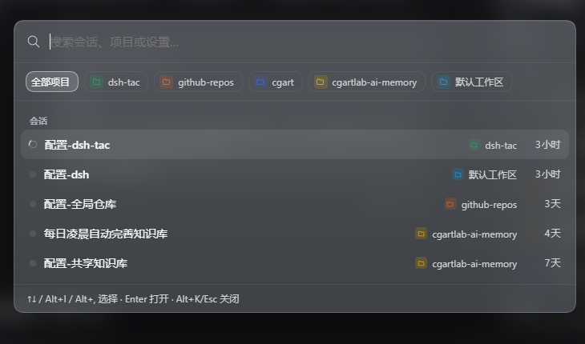

# dsh-tac

[](https://github.com/cgartlab/dsh-tac/actions/workflows/check.yml)
[](https://www.npmjs.com/package/dsh-tac)
[](https://creativecommons.org/licenses/by-nc-sa/4.0/)

[English](README.md) | 中文

一个 [DeepSeek Harness](https://deepseek.com) 客户端插件，把 Harness 变成项目感知的工作台：
原生右侧栏的全局项目/会话看板、浮动会话 HUD、键盘优先的会话导航、按住即滚的长对话阅读，
以及桌面级的任务通知。



| 悬浮会话列表 | 命令面板（会话 / 项目 / 设置） |
| --- | --- |
|  |  |

## 功能

- **项目看板** —— 会话与项目两种数据库视图，支持搜索、状态/类型/项目筛选、分组、多列排序、
  归档感知的行，以及每个项目自定义图标与颜色。会话表可以**按任意会话属性分组**——项目、状态、类型（自动化/普通）、预设、更新时间分段（今天/昨天/本周/更早）、当前会话——分组维度在工具栏下拉或设置页里选，选择会记住；每个分组头都能单独折叠。项目视图有 6 列属性（会话总数 / Open Issue / Open PR /
  本地内部版本 / 最新上线版本 / 最近活动时间）。**点击项目行会在下方展开该项目的会话列表**（手风琴式，
  不再翻到会话页）。支持窄（380px）、中（50vw）、原生全屏三种呈现，同一个键打开、再按关闭——
  每个尺寸键都是独立开关：看板开着时按任意尺寸键都关闭，关闭时按哪个键就以哪个尺寸打开。
  面板的开关与大小属于工作区而非每个对话：切换会话只切换对话，不会重新打开、关闭、
  改变看板尺寸或改动你拖出来的宽度。
  会话列表超过 200 条时先渲染前 200 条，底部可「显示更多」；改筛选或搜索会回到第一批。
  右侧面板里的看板与全屏主面板的看板是两个独立实例，各自记住自己的视图，互不影响。
- **悬浮会话 HUD** —— 实时展示活跃/最近会话、计时、待处理提醒、自动化任务标记，可拖拽移动，
  胶囊 ⇄ 列表带动画收起展开；打开原生左侧会话栏时会收成胶囊贴在它的右侧，关闭后复位
  （拖过的列表保持自己的纵向位置；仍在默认锚点的只是收起，不会被甩到别处）。只有一条稳定排序：活跃会话优先，同组内最近活动在前；
  切换会话只移动高亮、不重排列表，`⌥+I` / `⌥+,` 严格按这个顺序循环。
- **命令面板**（`⌥+K`） —— 模糊搜索会话与项目，现在也能搜「设置」（输入框提示
  「搜索会话、项目或设置…」）。输入关键词后，结果按三组分区展示：**设置**（宿主自己的
  设置分区，实时发现）、**项目看板设置**（插件设置页的 6 个分区：快捷键 / 顶部功能按钮 /
  界面与行为 / GitHub 数据源 / 日志与排查 / 数据）、**会话**（原来的结果）。设置行有独立的
  图标和分组标题，与会话区分；`⌥+I` / `⌥+,` / `↑` / `↓` 跨分组连续移动，`Enter` 打开会话
  或跳转到设置项。空关键词时保持原样、只列熟悉的会话列表；项目筛选 chip 只作用于会话，
  因为设置是全局的。选中设置项会打开宿主设置页并定位到对应分区；插件设置项还会在设置页里
  滚动到该分区并短暂高亮。设置页打开了却没法自动定位到分区时，也会弹提示说明，不会让你
  以为已经跳过去了；完全打不开时才提示从左侧栏进入。宿主或其它插件以后新增的设置分区会
  自动出现在搜索里，不用等插件更新。
- **单独查看已归档的会话** —— chip 里有一个「只看已归档」（归档图标），点一下列表就只剩
  归档过的会话，再点一次回到全部。每条归档会话右侧有**取消归档**按钮，点它当场恢复，
  不用退出搜索、也不用去别的界面；键盘上用 `Shift+Enter` 恢复当前高亮的归档行（只有选中
  归档行时，底部提示里才会出现这个快捷键）。这个筛选是显式请求，所以即使设置里关掉了
  「搜索时包含已归档会话」，打开它照样能看到归档内容。`Esc` 会先清掉筛选（项目和归档一起），
  再按一次才关闭面板。
- **按住滚动阅读** —— 按住快捷键平滑滚动对话，在到达边界前自动预载更早历史（需开启
  「滚到顶自动加载历史」）；当聊天视图回弹位置写入时，退化为按消息锚点分步上移。按住 `⌥+M` 滚到最下方后
  会激活输入框，可以立刻输入回复。
- **滚到顶自动加载历史** —— 长会话滚到顶部时自动加载上一页更早的消息，不用再手动点
  「加载更早」；默认开启，可在设置里关闭。走的是宿主原生分页，加载提示、失败提示和
  加载后的滚动位置保持都与手动点击一致。
- **任务通知** —— 会话完成、等待回答或请求权限时，在会话面板右下角弹出应用内卡片并播放提示音；
  应用在后台时改用系统通知，并完整带出问题文本与全部选项。**失败的回合报「任务失败」而不是
  「任务完成」**，并把可读的原因写进正文；审批原因若是 `{en, zh}` 这类对象，会取出文本而不是
  显示 `[object Object]`。
- **快捷键冲突检测** —— 录入与插件自身或 DSH 内置命令重复的组合会被当场拒绝，
  已保存的冲突会在启动时与设置页中提示。
- **日志与排查** —— 可选本地日志（错误/警告/常规/细节四种级别），内存里留最近若干条，设置页可一键复制或清空；启动时检查与内置命令的快捷键冲突，并记录页面报错和未处理的 Promise 异常。
- **设置联动** —— 关掉某个功能后，它自己那些子设置（比如看板的面板宽度、默认视图、显示哪些列）会变灰并禁用，避免改了没反应、以为设置坏了；开关本身永远可点。
- **悬浮列表归档** —— 鼠标悬停在会话行上时，右侧运行时间会换成归档按钮；搜索列表可包含已归档会话（带「已归档」标记），由设置控制，默认打开。
- **GitHub 数据源** —— 在「设置 → GitHub 数据源」为每个项目指定其 GitHub 仓库（owner/repo，自动按路径预填仓库名）与本地版本，看板的 Open Issue / Open PR / 最新上线版本列就会显示从 api.github.com 读取的真实数字（Personal Access Token 可选，公开仓库可不填）；未配置的项目仍显示「—」占位。

## 快捷键

所有快捷键都可在 **设置 → 项目看板设置** 中修改。默认值：

在 macOS 上，`⌥` 是 Option 键，`⌃` / `⇧` / `⌘` 分别是 Control / Shift / Command；
`⌥+…` 对应的就是物理 Option 键。Windows / Linux 上仍显示为 `Alt+…` / `Meta+…`。
存储的按键绑定在所有平台保持一致，已保存的快捷键无需迁移。

| 快捷键 | 行为 |
| --- | --- |
| `⌥+K` | 开/关命令面板（会话、项目与设置）—— 面板内 `⌥+I` / `⌥+,` / `↑` / `↓` 跨分组移动选择，`Enter` 打开会话或跳转到设置项，`Shift+Enter` 恢复高亮的归档行 |
| `⌥+I` / `⌥+,` | 上一个 / 下一个会话 |
| `⌥+U` / `⌥+M` | 上一条 / 下一条用户指令（点按跳转，按住滚动） |
| `⌥+S` | 滚动到底并聚焦输入框 |
| `⌥+D` | 会话操作弹窗（归档 / 停止运行中的回合 / 客户端开放删除接口时可删除） |
| `⌥+N` / `⌥+B` / `⌥+V` | 看板窄 / 中 / 全屏。看板开着时按其中任意一个都关闭；关闭时按哪个就打开成哪个尺寸 |
| `⌥+W` | 显示/隐藏原生左侧栏；全屏看板下先退出全屏 |
| `⌥+R` | 重命名当前会话 |
| `⌥+E` | 收起 / 展开悬浮会话列表 |
| `⌥+Enter` | 把最早一条排队消息插话发送到运行中的回合 |

命令面板打开时：**窗口级**的键（看板 / 左侧栏 / 悬浮列表 / 重命名 / 会话操作）会先关掉面板再执行，
你能看到结果；**对话级**的键（插话、按住滚动、跳到底、会话循环）不执行，避免隔着搜索框打断打字。

## 环境要求

- 支持客户端插件的 DeepSeek Harness 构建，并带有 `dsh-client-ui-sidebar`、
  `dsh-client-ui-workspace`、`dsh-client-ui-session` 客户端包。
- Node.js 18+ 仅用于仓库检查；插件本身由 Harness 加载。

**已验证的版本**：DSH `0.2.2-rc.1`（macOS / Windows 桌面版与 Web UI）。
DSH 处于开发者预览期，插件用到的都是公开客户端服务，但上游若有破坏性改动仍可能需要更新；
遇到问题请附上 DSH 版本开 issue。

## 安装

装之前只需要两样东西：**已装好的 DeepSeek Harness（DSH）**，以及**能访问 GitHub**。
不需要 Node 环境、不需要 `npm install`——插件的运行时零依赖，React 由 DSH 自己提供。

### 方式一：在 DSH 界面里装（最简单）

不用碰命令行：

1. 打开 DSH，点左侧栏的 **「插件」**；
2. 点右上角的 **「+ 添加插件」**；
3. 在输入框里填 **`dsh-tac`**（也可以填 GitHub 地址或本地目录路径）；
4. 点 **「安装」**，装完**重启 DSH**。

装好之后这条会出现在「已安装插件」列表里，带一个开关。安装器会自动把插件注册到你正在用的
profile，不用手改任何配置文件。接着看下面的**「装完看什么」**和**「没出现怎么排查」**——
这两节对两种安装方式都适用。

### 方式二：用命令行装

**先找到 `dsh` 命令。** 桌面版自带的 CLI 不在 PATH 里，它在这里：

| 平台 | 路径 |
| --- | --- |
| Windows | `%LOCALAPPDATA%\Programs\DeepSeek Harness\resources\runtime\cli\bin\dsh.cmd` |
| macOS | `/Applications/DeepSeek Harness.app/Contents/Resources/runtime/cli/bin/dsh` |

想省事就把它加进 PATH，之后直接用 `dsh`；不加就用完整路径。macOS 上不改 PATH 时，整条命令是：

```bash
"/Applications/DeepSeek Harness.app/Contents/Resources/runtime/cli/bin/dsh" plugin --profile desktop add dsh-tac
```

Windows PowerShell 里把 `dsh` 换成完整的 `.cmd` 路径：

```powershell
& "$env:LOCALAPPDATA\Programs\DeepSeek Harness\resources\runtime\cli\bin\dsh.cmd" plugin --profile desktop add dsh-tac
```

**再确认你的 profile 名。** 它就是你平时在用的那套配置，看这个目录里有什么：

```bash
ls ~/.dsh/profiles/
```

桌面版通常是 `desktop`，`npx @deepseek-ai/dsh web` 起的是 `web`，也可能有你自己建的其它 profile。
要用 DSH 实际在跑的那一个。**这一步别猜**——装错 profile 的话插件会装好但完全不出现。

然后安装（把 `desktop` 换成上一步看到的那个名字）：

```bash
dsh plugin --profile desktop add dsh-tac
```

它从 npm 装（`dsh plugin` 会把 `add <包名>` 原样转给该 profile 里的 pnpm）。想跟仓库 `main` 分支的最新提交时，改用源码形式：

```bash
dsh plugin --profile desktop add github:cgartlab/dsh-tac
```

上面两条命令都会**自动把插件注册进该 profile 的 `dsh.profile.bundles`**（不需要手动改 json），最后**重启 DSH**。

### 装完看什么

两种安装方式的结果一样。**完全重启** DSH 后，你会立刻看到：

- 左下角多了一块**悬浮会话列表**（[截图](docs/screenshots/hud.png)）；
- 会话顶部多了**搜索框和几个按钮**；
- 打开右侧面板，或按 `⌥+N` / `⌥+B` / `⌥+V`（Windows / Linux 为 `Alt+N` / `Alt+B` / `Alt+V`）
  以窄 / 中 / 全屏尺寸打开**项目看板**（[看板截图](docs/screenshots/board.png)）；
  按 `⌥+K`（Windows / Linux 为 `Alt+K`）打开[命令面板](docs/screenshots/palette.png)。

### 没出现怎么排查

这一节对两种安装方式都适用，按顺序查：

1. **profile 名装错，或没注册上。** 再跑一次 `ls ~/.dsh/profiles/`，确认 `--profile` 填的就是
   DSH 实际在用的那个。`~/.dsh/profiles/<名字>/package.json` 的 `dsh.profile.bundles` 里应该有
   `dsh-tac`（`dsh plugin add` 和界面安装都会自动写进去，只有确实缺了才手动补）。同目录的
   `cordis.yml` 是 DSH 生成的，别手改。
2. **插件被关了。** 左侧栏 **「插件」** 页的「已安装插件」里，确认 `dsh-tac` 的开关是开的。
3. **没完全重启进程。** 关窗口不等于退出：macOS 用 `⌘+Q`，Windows 从托盘图标退出，再重新打开
   DSH。客户端 bundle 只在启动时加载。
4. **残留旧包名。** 插件历史上曾用 `@local/dsh-project-board` / `@local/dsh-tac` 发布过；很久以前
   装过的话，检查 profile 里有没有残留旧条目——旧别名不会加载现在的 `dsh-tac` 包。
5. 还不行就打开 **「⋯ 更多 → 设置 → 项目看板设置 → 日志与排查」**，把级别调到「常规信息（推荐）」，
   重启后看有没有 `plugin ready` 记录。

### 插件的设置在哪儿

DSH 左侧栏最底部点 **`⋯ 更多` → `设置`**（快捷键 `Ctrl+,`），再点左侧导航里的
**「项目看板设置」**。那里能改全部快捷键、悬浮列表行为、看板默认视图、GitHub 数据源
和日志级别。

### 方式三：本机开发时链接源码

改了代码想看效果时用这个，装的是你本地这份：

```powershell
plugin_manager install_bundle target="<本仓库路径>"
```

包名为 `dsh-tac`，以 `dsh-tac` 这个 loader 条目插入。`package.json` 暴露
`dsh.bundle.patch` 与 `dsh.client`；插件注入 `conversation.header.leading`、
`conversation.session.header.utilities`、`conversation.composer.dock`、`shell.overlay`
和 `settings.section`。

### 改完代码怎么让它生效

插件是客户端 bundle，改完 `src/` 要重新构建再热重载：

```bash
npm install        # 只需第一次
npm run build      # src/ → client.js + index.js
```

然后在 DSH 里把插件**禁用再启用**一次（设置 → 插件 → `dsh-tac`），或按 `Ctrl+R` 重新加载窗口。
构建产物是提交进仓库的，`npm run check` 会校验产物与源码一致。

### 卸载

```bash
dsh plugin --profile desktop remove dsh-tac
```

或在「设置 → 插件」里禁用 `dsh-tac`。插件不写任何 DSH 数据；卸载后残留的只有它自己的设置与日志（存在浏览器 localStorage 里），可以随插件一起清掉。

### 权限与数据

- 读会话列表与状态、切换会话、重命名、归档——全部通过 DSH 公开的客户端服务，**不读会话内容**。
- 可选：读 GitHub 公开 API 以显示 Open Issue / PR / 最新版本。**只在你自己在设置里填了仓库映射后才发请求**；填 token 才能读私有仓库，token 只存在本机。
- 可选：系统通知（需要 DSH 或操作系统授予通知权限）。
- 设置与日志只存在本机的浏览器 localStorage 里；不写任何 DSH 数据、不上传，运行时零依赖。

---

## 实现方式

插件用 **TypeScript** 写在 `src/` 下，由 esbuild 编译成单文件客户端 bundle（`client.js`）。
bundle 通过 Harness 客户端模块加载器加载，只使用公开客户端能力（`ctx.slots`、
`ctx.sidebarRight`、`ctx.layout`、`ctx.get('workspaces')`、会话状态 store）以及宿主提供的
React，自身没有运行时依赖；宿主侧 `index.js` 刻意保持 no-op。

这是一个**客户端插件**：必需的 `apply(ctx)` 入口按 DSH 客户端插件的约定导出——
`window.__ModuleLoader__.load({ id, factory })`，factory 返回 `{ inject, apply }`
（见 `src/index.ts`）。顶层 `index.js` 是空的，因为全部逻辑跑在浏览器里；所以审核时找
`apply` 请读 `src/index.ts` / `client.js`，不要看 `index.js`。

- `src/index.ts` —— Harness 注入的入口：绑定宿主 React、调用 `apply`
- `src/apply.ts` —— 字典、样式、store、原生看板/侧栏动作、插槽注册
- `src/features/` —— 看板、悬浮列表、搜索面板（含快捷键分发）、通知、弹窗、设置页、对话滚动
- `src/core/` —— 设置与迁移、日志、组合键、store、DOM 探测、自动化/模式数据源、命令面板设置索引
- `src/i18n/` —— zh/en 字典（键不一致会直接编译失败）
- `client.js`、`index.js` —— 构建产物（不要手改）
- `cordis.patch.yml` —— bundle 插入声明
- `locale/` —— zh/en 尾部字符串
- `scripts/` —— 构建脚本 + 本地与 CI 使用的清单、语法、i18n 检查
- `docs/architecture.md` —— 插槽映射、状态、键盘与通知内部实现

## 已知限制

- 会话删除取决于客户端契约；当前 DeepSeek Harness 构建没有开放删除接口，
  因此会话弹窗会禁用删除并提示改用归档。
- 归档仍在运行的会话会被宿主拒绝，弹窗会显示错误而不是强行执行。
- 系统通知受操作系统/浏览器通知权限影响，提示音受 Harness WebView 的自动播放策略影响。
- 插件面向当前客户端插槽与服务接口；若 Harness 更新重命名这些插槽，需要同步更新插件。

## 开发

```bash
npm ci                 # 安装 typescript + esbuild
npm run typecheck      # tsc --noEmit（strict）
npm run build          # src/ -> client.js + index.js
npm run check          # 类型检查 + 清单/exports/语法 + i18n 一致性
npm test               # bundle 加载测试 + 快捷键回归
```

`client.js`、`index.js` 都是由 `src/` 生成的；CI 会重新构建，若提交的产物与源码不一致就失败。
这些检查都会在每次推送和 PR 时由 CI 执行（`.github/workflows/check.yml`）。

## 市场提交材料

提交插件市场时需要的字段，以及每项在仓库里的位置：

| 字段 | 内容 / 位置 |
| --- | --- |
| 一行价值 | 给 DeepSeek Harness 加上键盘优先的项目看板、悬浮会话列表与命令面板，一眼看全所有会话与项目。 |
| 分类 | DSH 客户端插件 · 效率 / 项目管理（GitHub topic `dsh-plugin`，`package.json` 的 `keywords`）。 |
| 安装命令 | `dsh plugin --profile <profile> add dsh-tac`，或在 DSH 界面点「+ 添加插件」；完整步骤见上方**「安装」**。 |
| 兼容性 | 已在 DSH `0.2.2-rc.1` 验证（macOS / Windows 桌面版与 Web UI）；Node 18+ 仅用于仓库自检，见**「环境要求」**。 |
| 许可证 | `CC-BY-NC-SA-4.0` —— `package.json` 的 `license`、页首徽章与下方**「协议」**。 |
| 截图 | `docs/screenshots/board.png`、`hud.png`、`palette.png`，三张都已嵌在本页上方；抓图要求与新鲜度规则见 [docs/screenshots.md](docs/screenshots.md)，由 `npm run check` 校验。 |
| 权限与数据 | 见上方**「权限与数据」**：只读会话列表与状态，可选 GitHub API 与系统通知，不读会话内容、不上传。 |

## 协议

采用 [Creative Commons Attribution-NonCommercial-ShareAlike 4.0 International](https://creativecommons.org/licenses/by-nc-sa/4.0/)，
与 [cgartlab.com](https://cgartlab.com) 相同。

Copyright (c) 2025-2026 CGArtLab.


